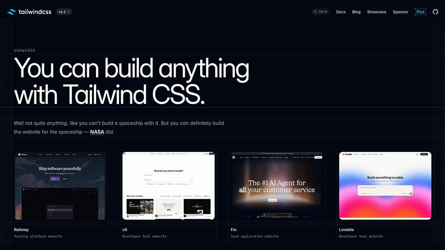

<header>
  <h3 align="center">
  
  <br>
  Base Repository 🖨️🪴
  
</h3>

<p align="center">
  <a href="https://github.com/NikolaM-Dev/base-repo_tmpl/blob/main/LICENSE"></a>
  <a href="https://github.com/NikolaM-Dev/base-repo_tmpl/contributors"></a>
  <a href="https://github.com/NikolaM-Dev/base-repo_tmpl/stargazers"></a>
  <a href="https://github.com/NikolaM-Dev/base-repo_tmpl/issues"></a>
  <a href="https://github.com/NikolaM-Dev/base-repo_tmpl/commits/main/"></a>
</p>

<div align="center">
  <figure>
    
    <br>
    <figcaption><i>Base template preview</i></figcaption>
  </figure>
</div>
</header>

&nbsp;

<details><summary>👉 Table of Contents</summary>

- [📍 Overview](#-overview)
- [✨ Features](#-features)
- [⛅ Behind The Code](#-behind-the-code)
  - [🌈 Inspiration](#-inspiration)
  - [💡 Challenges / Learnings](#-challenges--learnings)
- [⚡ Quick Start](#-quick-start)
  - [🏕️ Run Locally](#️-run-locally)
  - [🛣️️ ROADMAP](#️️-roadmap)
- [🫂 Acknowledgments](#-acknowledgments)
- [🌟 Star History](#-star-history)

</details>

## 📍 Overview

> A README-first starting point for new GitHub repos 🎇🎉

A minimal template with a consistent README, ROADMAP, MIT LICENSE, and Justfile.
Logos, footer, and social icons load from versioned URLs in this repo, so new
projects stay lean and every README renders the same way.

## ✨ Features

- **Remote-hosted assets** logo, footer, and icons load from tagged URLs, new
  repos ship no binaries.
- **README-first layout** Overview, Features, Behind The Code, Quick Start,
  Acknowledgments, and Star History in one consistent shape.
- **One-command render** `just readme` fills owner, branch, and license holder
  mechanically, content stays explicit.

## ⛅ Behind The Code

### 🌈 Inspiration

Built for spinning up small repos without redesigning the README each time,
starting from the minimalism of `bare-minimum`.

### 💡 Challenges / Learnings

- Pinning asset URLs to a tag keeps downstream READMEs stable when this repo
  moves.
- Slug replacement is one rule: everywhere except `raw.githubusercontent.com`
  lines.
- GitHub keeps variation selectors in heading IDs, so TOC anchors must carry
  U+FE0F.

## ⚡ Quick Start

### 🏕️ Run Locally

```bash
git clone https://github.com/NikolaM-Dev/base-repo_tmpl.git
cd base-repo_tmpl
```

### 🛣️️ ROADMAP

See the [ROADMAP](./ROADMAP.md) for upcoming features, feel free to fork, tweak,
or open an issue if you spot a bug or want to collaborate.

## 🫂 Acknowledgments

- [2KAbhishek/bare-minimum](https://github.com/2KAbhishek/bare-minimum) for
  project inspiration.
- [catppuccin/catppuccin](https://github.com/catppuccin/catppuccin) for the
  README assets.
- [Showcase - Tailwind CSS](https://tailwindcss.com/showcase) for the preview
  image.
- [eli64s/readme-ai](https://github.com/eli64s/readme-ai) for the Table of
  Contents summary.

## 🌟 Star History

<a href="https://www.star-history.com/#NikolaM-Dev/base-repo_tmpl&type=date&legend=top-left">
 <picture>
   <source media="(prefers-color-scheme: dark)" srcset="https://api.star-history.com/svg?repos=NikolaM-Dev/base-repo_tmpl&type=date&theme=dark&legend=top-left" />
   <source media="(prefers-color-scheme: light)" srcset="https://api.star-history.com/svg?repos=NikolaM-Dev/base-repo_tmpl&type=date&legend=top-left" />
   
 </picture>
</a>

&nbsp;

<footer>
  <p align="center"></p>

  <p align="center">
    <a href="https://x.com/nikolam_dev" target="_blank"></a>
    <a href="https://www.linkedin.com/in/nikolam-dev" target="_blank"></a>
    <a href="https://github.com/NikolaM-Dev" target="_blank"></a>
    <a href="#readme" target="_blank"></a>
  </p>
</footer>
